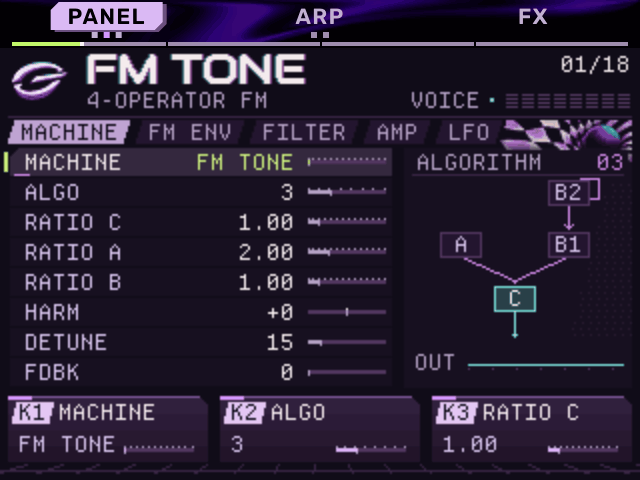
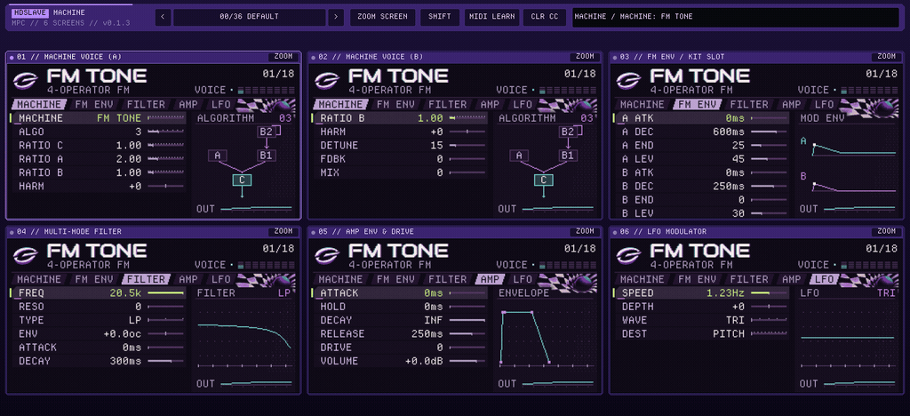

# hdslave Machine

**An 18-engine multi-machine synthesizer and drum groove voice in the style of Elektron's machines, as a CLAP plug-in for the Akai MPC Sample.**

<table>
  <tr>
    <th width="34%">MPC Sample</th>
    <th width="66%">macOS and Windows · CLAP</th>
  </tr>
  <tr>
    <td align="center"><a href="docs/machine-screen.gif"></a></td>
    <td align="center"><a href="mac-clap/assets/desktop-preview.gif"></a></td>
  </tr>
</table>

> **Desktop CLAP version (macOS & Windows):** A separate desktop CLAP build with all MPC screens on one interactive panel lives in [**`mac-clap/`**](mac-clap/) (`cd mac-clap && ./install-macos.sh`). Releases in this repo stay MPC Sample-only for now while the desktop builds are being finalized.

Built for the Akai MPC Sample running [Melodee](https://github.com/keremimo/melodee-sample) / [hdslaveOS](https://github.com/hdslave/hdslaveOS) (64-bit ARM Linux, Cortex-A55). Hosts list it as **hdslave Machine** (id `com.hdslave.machine`, version 0.1.7). Switch between 18 distinct synthesis and percussion engines on the fly:

- **FM TONE:** an 8-voice, four-operator FM synthesizer with 8 algorithms and dedicated modulator envelopes.
- **Seven drum machines:** BD, SD, CP, HH, CY/CB, EFM DRUM, and GND.
- **KIT:** eight independent drum slots playable together from a single track.
- **Eight experimental voices:** **TERRAIN** (wave terrain), **PHASE** (vector phaseshaping), **VOX** (VOSIM), **MODAL** (struck resonator), **PLUCK** (plucked string), **GENDY** (dynamic stochastic), **PULSAR**, and **ORGAN**.
- **KICK:** a resonator kick in the style of Korg's volca kick, with all ten of its controls.

Every machine runs through a shared voice section — filter with its own envelope, drive, amp envelope, and a routable LFO targeting pitch, filter, level, or any Data knob. Machine renders its raised-banner screen and live visualizers through `melodee.screen/1` on Melodee 0.7 and hdslaveOS builds based on it. Hosts without the extension can use the standard CLAP parameters.

## Machines

MACHINE picks one. Data A–H (and for KICK also I and J) then mean what that machine says. A new machine sets its
Data to its own defaults (a good sound of it), and the host is told. A saved project or a preset keeps the Data it had.

Going to KIT and back to the machine you left keeps its Data. A saved project remembers that machine; after a preset,
leaving KIT starts any machine from its defaults. A host's reset to default sets a Data knob to FM TONE's default,
whatever the machine: CLAP lets a plug-in change its defaults only while it is off.

| Machine | A | B | C | D | E | F | G | H |
|---|---|---|---|---|---|---|---|---|
| FM TONE | ALGO (1–8) | RATIO C | RATIO A | RATIO B | HARM ± | DETUNE | FDBK | MIX |
| BD | TUNE | DECAY | SWEEP | SWP TIME | CLICK | DRIVE | FM | NOISE |
| SD | TUNE | TONE DEC | NOIS DEC | SNAPPY | BODY | FILTER | DRIVE | – |
| CP | BURSTS (1–8) | SPREAD | DECAY | TONE | FILTER | ROOM | – | – |
| HH | MODE (CLOSED / OPEN) | TONE ± | DECAY | FILTER | METAL | NOISE | – | – |
| CY/CB | MODE (CY / CB) | TONE ± | DECAY | RING | FILTER | – | – | – |
| EFM DRUM | PITCH | RATIO | INDEX | P DECAY | I DECAY | A DECAY | SWEEP | NOISE |
| GND | SOURCE (SINE / NOISE / IMPULSE) | PITCH | DECAY | SWEEP | – | – | – | – |
| TERRAIN | SURFACE (6) | X ± | Y ± | WIDTH | HEIGHT | WARP | SPIN | DRIFT |
| PHASE | D | V | V ENV ± | ENV DEC | TWIN | SUB | FOLD | GRIT |
| VOX | TUNE ± | VOWEL | SHIFT | PULSES (1–8) | P DECAY | F ENV ± | F DEC | LENGTH |
| MODAL | TUNE ± | MATERIAL | BRIGHT | DAMP | POSITION | MALLET | NOISE | SCATTER |
| PLUCK | TUNE ± | DECAY | BRIGHT | PICK | POSITION | STIFF | BODY | TENSION ± |
| GENDY | POINTS (3–16) | AMP WALK | TIMEWALK | WILD | LOCK | SMOOTH | BOUNDS | RATE |
| PULSAR | TUNE ± | FORMANT | DENSITY | SHAPE | ENVELOPE | MASK (8) | JITTER | LENGTH |
| ORGAN | 16' | 5 1/3' | 8' | 4' | 2 2/3' | 2' | 1 3/5' | 1 1/3' |
| KICK | PITCH | BEND | TIME | DECAY | ATTACK | COLOUR | PULSE | DRIVE |

KICK's Data I is TONE and its Data J is ACCENT.

**FM TONE**
- **Operators:** C, A, B1 and B2.
  - RATIO C, A and B set their frequencies against the note; B1 and B2 share RATIO B.
  - DETUNE moves A up and the Bs down by up to 25 cents.
  - HARM bends the carrier's wave (+) or the modulators' (−) toward richer shapes.
  - FDBK feeds B2 back into itself.
- **Algorithms** (who modulates whom):

  | ALGO | Modulation | Heard |
  |---|---|---|
  | 1 | B2 → B1 → A → C | C |
  | 2 | (B1 + B2) → A → C | C |
  | 3 | B2 → B1 → C, A → C | C |
  | 4 | A → C, B2 → B1 | C, B1 |
  | 5 | B2 → A, B1, C | A, B1, C |
  | 6 | B2 → B1 | C, A, B1 |
  | 7 | (A + B1 + B2) → C | C |
  | 8 | none | all four |

- **MIX** blends C's output with the other heard operators (or, where only C is heard, A's).
- **FM ENV** (eight more parameters, FM TONE's alone) shapes the modulators' levels:
  - A's envelope sets A's level; B's sets B1 and B2's.
  - Each rises over ATK, falls to END over DEC and stays there.
  - LEV is how deep it goes.

**The drums**
- One hit at a time: a new one chokes the last over 3 ms.
- Two hits in one host block land on the same frame: the louder one plays once (a tie goes to the later).
- They ignore note-off and ring out.
- They don't follow the note's pitch; TUNE or PITCH sets it.

**The second barrage**
- **TERRAIN:** a point orbits a surface once a period (RIPPLE, SADDLE, LATTICE, DUNE, KNOT or CRATER), on an
  ellipse WIDTH by HEIGHT round (X, Y). The height under it is the sound. WARP packs the hills closer, SPIN turns the
  ellipse, and DRIFT lets its centre wander.
- **PHASE:** a cosine read through a phase bent at the point (D, V). V above D gives a formant. V ENV sweeps V; TWIN
  adds a mirrored, detuned copy; SUB an octave below; FOLD wavefolds; GRIT holds samples.
- **VOX:** each period starts PULSES sin² pulses at a formant, each softer by P DECAY, then silence. Two of them,
  VOWEL's formants (A, E, I, O, U and between), make a vowel. SHIFT moves the formants and F ENV sweeps them.
- **MODAL:** twelve resonating modes. Their ratios come from MATERIAL: a string's harmonics, a bar's, a drum skin's,
  a bell's. They're struck by a mallet (MALLET soft to hard) and NOISE. BRIGHT tilts them, DAMP shortens them,
  POSITION is the strike point, and SCATTER pulls the modes off their ratios. Where BRIGHT and POSITION add up to a
  louder strike than the default's, it's scaled back to it; NOISE eases off toward its top.
- **PLUCK:** Karplus-Strong. A burst of noise (PICK its brightness, POSITION a comb) goes round a damping filter
  (BRIGHT) and a loss (DECAY). STIFF stretches the overtones, BODY rings a wooden box, and TENSION starts the note
  sharp or flat and lets it settle. The line allows for what BRIGHT's filter and STIFF delay at the note's own pitch,
  so it stays in tune at any setting.
- **GENDY:** the waveform is POINTS breakpoints. Every few periods (RATE), each point's level and time take a random
  step (AMP WALK, TIMEWALK; WILD gives the steps heavy tails; BOUNDS are the walls they bounce off). LOCK holds the
  pitch at the note, and SMOOTH curves the lines.
- **PULSAR:** a pulsaret is one cycle at FORMANT times the note. SHAPE takes it from sine to saw to square to noise,
  and ENVELOPE from flat to falling to a bell. It's fired at the note, or up to eight octaves below it (DENSITY: from
  tone to a rhythm). MASK leaves some out; JITTER moves them.
- **ORGAN:** eight drawbars, 0–8 each, 3 dB a step. They come from one phase, so they stay locked, plus a key click.
  The LFO on PITCH is its vibrato.
- **KICK:** a resonator struck by a pulse (COLOUR from a clean click to a noisy burst, PULSE its level). Its PITCH is
  bent down from BEND octaves over TIME. Then come the amp (ATTACK, DECAY), DRIVE and TONE. ACCENT sets how far the
  velocity reaches and how hard it pushes the drive.
- **On their own,** the new machines follow the note, eight at once:
  - TERRAIN, PHASE, VOX, MODAL, PLUCK, GENDY, PULSAR and ORGAN use AMP RELEASE when you lift a pad, like FM TONE.
  - KICK plays one hit at a time, PITCH at C2 and the note moving it from there.
- **VOX and PULSAR** have a LENGTH of their own. Its top is INF, held until note-off.

**KIT**
- Notes 36–43 (a Melodee drum track's first eight pads) play slots 1–8.
- A slot may also be MODAL, PLUCK, VOX, PULSAR or KICK, played at C3 moved by its TUNE.
- MODAL and PLUCK slots ring out as one-shots when you lift the pad.
- Each slot has its own machine (BD to GND), Data A–H, LEVEL and PAN.
- A slot's new hit chokes only itself. A closed HH also chokes the open ones. On one frame the louder hit on a
  slot plays, and a closed hat beats an open one struck with it, whichever came first.
- The default kit: kick, snare, clap, closed and open hats, cymbal, an FM tom, a ground tone.

## The voice section

- **FILTER:**
  - FREQ, RESO, TYPE (low, high or band pass; zero-delay feedback);
  - ENV, ±7 octaves from its own envelope (ATTACK, then DECAY).
- **AMP:**
  - ATTACK opens the amp, HOLD keeps it fully open, and DECAY fades it to silence. At DECAY = INF the amp stays open
    while you hold the pad. Set a finite DECAY to hear HOLD delay the fade.
  - RELEASE fades a gated note from its current level when you lift the pad. For longer tails on MODAL, turn down
    its DAMP. On PLUCK, turn up the string's own DECAY (Data B).
  - DRIVE (soft clip) and VOLUME (0 dB at three quarters).
- **LFO:**
  - SPEED (0.05–30 Hz) and DEPTH (±).
  - WAVE: TRI, SAW, SQR, S+H or SINE.
  - DEST: PITCH (±1 octave), FREQ (±4 octaves), AMP, or DATA A–H.
- **MIDI:**
  - The mod wheel deepens the LFO; pitch bend is ±2 semitones.
  - CC 64 is the sustain pedal: notes let go under it sound on until it lifts (striking a held key again lets
    its earlier note go). CC 121 (reset all controllers) centres the bend and wheel and lifts the pedals.
  - Ties and slides (CC 68 / CC 84 naming the held key) move a pitched machine's sounding note to the next
    key with no new attack: a tie at once, a slide gliding over about 60 ms.
  - CC 123 (all notes off) releases every note; CC 120 (all sound off) stops them at once.
  - A key played again before its note-off lets go of the note it was playing. Melodee sends a key's repeats with
    one note-off at the end, so before 0.1.1 a held tone stacked copies of itself (hollow, combed, different each time).
  - Melodee gives every MIDI event of its 128-frame block the block's first frame, so (since 0.1.7):
    - the same key twice on one frame plays the louder hit once (a tie to the later), on every machine;
    - a note on and off on one frame (a note shorter than the block, such as a fast arpeggio's) plays to the end of
      the 32-frame step it started in, then releases from where its attack got. Before, a gated machine let it go
      before its first sample, and it was silent;
    - a note choked on the frame it was struck (CC 120 with it, a host's choke, a note stolen by a ninth) never
      sounds. Before, it played its 3 ms choke fade at full level.
  - A note-off or choke with a host's note id lets go of that note alone; Melodee's (no id) of all the key's.
- **Data at a note's own frame** (a step's automation, ahead of its note) play in that note: KICK's ACCENT, GENDY's
  POINTS, PLUCK's pick and MODAL's mallet take the step's value, not the step before's (0.1.1).
- **Gain and pan** glide across each 32-frame step, so LFO→AMP and level or pan automation don't step.
- **The filter:**
  - A voice ends when its machine is done and the filter has rung out, so a resonant filter is never cut off.
  - A voice's first step takes the filter envelope from its first sample, so a hit sounds the same wherever it lands.
  - Going into or out of bypass (fully open and flat) crossfades across a 32-frame step.
- **TERRAIN and PHASE** start mid-wave, so they fade in over 1 ms rather than click. VOX and PULSAR (unipolar
  pulses) settle their offset over the first 10 ms or so, as an AC-coupled output does.
- **A voice choked by a new machine** plays out its 3 ms fade with its own sound, never the new machine's. One struck
  on that frame never sounds.

## Presets

Default, FM Keys, FM Bell, FM Bass, FM Pad, Acid FM, Kick, Long Kick, Snare, Clap, Closed Hat, Open Hat, Cymbal,
Cowbell, FM Tom, Ground Sine, Kit, Terrain Drone, Terrain Bass, Phase Lead, Phase Acid, Vox Choir, Vox Knock, Marimba,
Gong, Pluck Harp, Pluck Bass, Gendy Insects, Gendy Buzz, Pulsar Rhythm, Pulsar Formant, Drawbar Organ, Full Organ,
Resonator Kick, Boom Kick, Kit Explorer (KICK, the new machines and the drums in one kit).

**Levels:** a drum hit peaks under full scale. A three-note chord peaks at up to about +2.5 dBFS, like the default FM
patch; Melodee's centre pan takes 3 dB off a track. Gong, Acid FM, Phase Acid, Full Organ, Pulsar Formant and Gendy
Buzz set VOLUME below 0 dB to stay there. There is no limiter by design: eight held FM voices at once peak at about
+9.8 dBFS (measured by the host tests), so full eight-note chords rely on the track's and master's headroom.

## The screen

Machine draws its own page through Melodee’s official screen extension (`src/melodee_screen.h`). The
page itself is `ui/`, built in when `ui/` is there (`make`; `make UI_DIR=...` for another copy). It shows:
- the machine across the top;
- the parameters as rows beneath it, grouped (MACHINE, FM ENV, SLOT, FILTER, AMP, LFO);
- a side panel that draws the group under the cursor;
- K1–K3's cards at the foot.

The controls:
- **Wheel:** moves the cursor.
- **Push:** edits the row under the cursor.
- **Minus / Plus:** jump a group.
- **K1–K3:** turn the cursor's row and the two after it.

`src/machine.cpp` builds the page's rows from the parameters. The page's edits become values the host is told to read
again, and wake the plug-in if it is asleep, so an edit made while stopped takes effect at once. The page asks for
paints while something moves, and the sound asks while it plays.

## Build and test

```sh
./build.sh          # builds build/Machine.clap and runs the tests, in Melodee's Linux arm64 build image
./build.sh sanitize # the host tests against an ASan + UBSan build
tools/bench.sh      # instructions a 128-frame block takes, per patch (callgrind)
```

**`tests/host.cpp`** loads the plug-in as a host does and checks:
- parameters, their ids and text;
- state and the 36 presets;
- FM TONE's pitch, ratios, bend, sustain and release, velocity, FM ENV, the eight algorithms and polyphony;
- every drum machine sounding, ending and choking;
- the second barrage on the note (by zero crossings or by period), ending once let go, and KICK's octaves and
  ACCENT;
- PULSAR's rhythm;
- a new machine's Data reset (all ten);
- KIT's keys, pan, hat choke and its new slot machines;
- the same output at any block size for every machine;
- 180 random and extreme patches staying finite, every machine at 22.05, 44.1, 48, 96 and 192 kHz;
- every pair of machines switched while notes sound (and KIT's slots), staying finite;
- MODAL in tune in the bass at 48 and 96 kHz; the same brightness at 96 kHz as at 48;
- MODAL and PLUCK amp attack, hold, decay and release, including their one-shot behavior in KIT;
- no click from the filter coming back from bypass, nor from a stolen voice;
- PLUCK's low notes at 96 kHz;
- every parameter's text read back as itself (each Data under each machine);
- the host's copy of a Data value right after a machine change in the same block;
- a key played again before its note-off (striking alone, not stacked), and note-offs and chokes by note id;
- two hits on one frame (the louder plays; KIT's closed hat beats an open one either way round), the sustain
  pedal, ties and slides (CC 68/84), CC 121, a velocity-0 note-on's own note id, refused future-version states
  and zero sample rates, and a process call with nowhere to write;
- on the gated machines, the same key twice on one frame (the louder plays, the later quieter hit to the bit not at
  all), a note on and off on one frame (it sounds about as one held for a block, at any block size, let go by its
  off, the pedal or CC 123), and on the drums, KIT and the gated machines a hit choked on its own frame (CC 120, a
  choke, Melodee's CC 120/123 storm) staying silent, and a ninth note on one frame stealing the first before it sounds;
- a Data value set at a note's own frame playing in that note (KICK, PLUCK, MODAL, GENDY, FM TONE);
- with the screen built in, the page: it paints, K1–K3 follow the cursor, edits change parameters, and the machine
  changes from its own row.

It also writes demo renders to `build/demo/`.

**`tests/fingerprint.cpp`** hashes every output sample of 101 fixed scenarios against `tests/fingerprint.txt`. Work
meant to keep the sound must leave them as they are; `make fingerprint-update` records a meant change.

**Cost** in instructions a block on the MPC's Cortex-A55 (callgrind, 128 frames at 48 kHz):

| Patch | Instructions a block | Share of one core |
|---|---|---|
| Eight held FM voices with everything busy | 210,000 | about 4.4% |
| An FM chord struck again each second, releasing the last | 87,000 | about 1.8% |
| A busy KIT groove | 45,000 | about 0.9% |
| Silence | 3,000 | about 0.06% |

With eight voices each (the filter on), the second barrage runs from 2.4% to 3.6% of a core:

| Machine | Share of one core |
|---|---|
| GENDY | 2.4% |
| PULSAR | 2.6% |
| TERRAIN | 2.9% |
| ORGAN | 3.0% |
| VOX | 3.1% |
| PLUCK | 3.2% |
| PHASE | 3.3% |
| MODAL | 3.6% |

KICK hitting every sixteenth takes 0.55%.

The page costs the audio thread nothing but a 128-sample copy a block. On the screen thread, a full repaint is about
390,000 instructions (TERRAIN's surface about 480,000), so 0.2–0.3 ms on the MPC. The plug-in asks for at most 30
paints a second, and only while something moves; most of them redraw just the meters and the scope.

Data values, the shared section's coefficients, FM TONE's steps and MODAL's modes (only their tuning follows a pitch
LFO) are worked out again only when what they come from changes. Cut into 1-frame host blocks (`build/bench flood`,
ORGAN's eight held voices, callgrind per 128 samples), the same sound takes 559,826 instructions (about 11.7% of a
core) against 137,179 in 128-frame blocks, so per-fragment work dominates there; without the per-voice coefficient
cache it measured 730,542. The cache removes about a quarter in that shape, against about 3.6% in steady blocks
(142,353 to 137,179).

## Install

Copy `build/Machine.clap` to `Melodee/Plugins/hdslave/hdslave Machine.clap` on the card. Then pick it on an
empty track: Stage, Plugin, hdslave, hdslave Machine. It needs only libc and libm.

Not tried on the MPC Sample yet.
